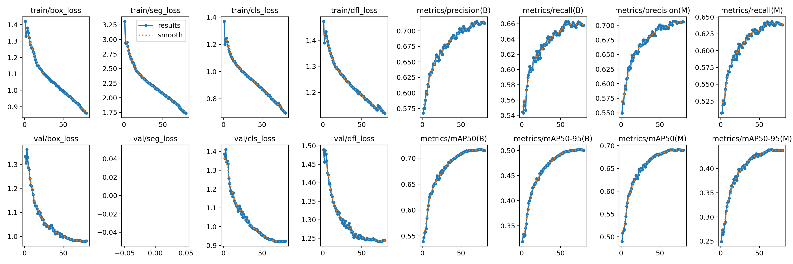

# FieldBQC: Boundary Supervision and Region-Boundary Quality Calibration for Multi-Region Field Instance Segmentation

**Field instance segmentation in heterogeneous remote sensing imagery using YOLO11x-seg, parcel boundary supervision, and instance quality calibration.**

FieldBQC combines Parcel Boundary Auxiliary Supervision (PBAS) with Region-Boundary Quality Calibration (RBQC). PBAS learns field boundaries through BCE and Boundary Dice supervision. RBQC estimates region and boundary quality to recalibrate instance confidence scores.

The study uses **FieldSeg-15K**, a multi-region subset containing **15,000 images** and **403,199 field instances** from DDFHAPD, FBIS-22M, and FTW. On the fixed test set, the paper reports a three-run Mask mAP50-95 of **0.420 +/- 0.004** for FieldBQC.

This project contains the four main checkpoint configurations, their archived figures, and the paper's test-result summaries. The relationship between the archived `abc` checkpoint and the paper's FieldBQC runs is described under [Model Preparation](#model-preparation).

## Prerequisites

### Project Preparation

From the directory containing the project, enter `./FieldBQC` before following the setup instructions:

```powershell
cd ./FieldBQC
```

File and output-directory arguments in the training and test evaluation entry points are relative to the project root. These entry points locate that root from their own files, so moving the project or launching them from another working directory does not change these references. Dataset split entries are relative to the directory containing `./data/datasets.yaml`.

### Environment Setup

Use Python 3.10 with a PyTorch and torchvision installation suitable for your hardware. Install the local Ultralytics source and the additional Python packages imported by its custom layers:

```powershell
python -m pip install -e ./src
python -m pip install timm einops
```

Dependencies declared by the local package are listed in [pyproject.toml](./src/pyproject.toml). Custom modules can require additional packages; the archive does not contain a complete pinned training environment. For historical reproduction, reuse the environment associated with the original checkpoint.

The custom heads and losses are part of the local source. Check that Python imports this copy:

```powershell
python -c "import ultralytics; print(ultralytics.__file__)"
```

The printed path should point to this project's `src/ultralytics` directory.

Check path handling without loading model weights or running inference:

```powershell
python -m unittest discover -s tests -v
```

## Model

### Paper Configurations

The paper evaluates four progressive configurations:

| Configuration | Components | Purpose |
|---|---|---|
| Baseline | YOLO11x-seg | Reference instance segmentation model |
| A | Boundary Dice | Boundary supervision ablation |
| A+B | PBAS: BCE + Boundary Dice | Joint parcel boundary supervision |
| FieldBQC | PBAS + RBQC | Boundary supervision and region-boundary quality calibration |

### Model Preparation

The following trained checkpoints are included under `./model`. Model YAML files are stored under `./src/ultralytics/cfg/models/11`.

| Archived Stage | CLI Stage | Model Configuration | Trained Checkpoint |
|---|---|---|---|
| Baseline | `baseline` | [yolo11x-seg.yaml](./src/ultralytics/cfg/models/11/yolo11x-seg.yaml) | [best.pt](./model/baseline/best.pt) |
| A | `a` | [yolo11x-seg-boundary-dice.yaml](./src/ultralytics/cfg/models/11/yolo11x-seg-boundary-dice.yaml) | [best.pt](./model/a/best.pt) |
| A+B | `ab` | [yolo11x-seg-bas.yaml](./src/ultralytics/cfg/models/11/yolo11x-seg-bas.yaml) | [best.pt](./model/ab/best.pt) |
| A+B+C | `abc` | [yolo11x-seg-bas-mqc.yaml](./src/ultralytics/cfg/models/11/yolo11x-seg-bas-mqc.yaml) | [best.pt](./model/abc/best.pt) |

The archived implementation names its complete configuration `BAS + Boundary Dice + MQC` (`A+B+C` / `abc`); the paper names its complete method `PBAS + RBQC` (`FieldBQC`). A checkpoint-to-paper-run mapping has not been verified, so the paper's three-run test values are reported separately from these four checkpoints. Renaming the project to FieldBQC does not establish that mapping.

The archive contains one `best.pt` per stage. It does not contain all 12 checkpoints used for the paper's three-run summaries or checkpoints for comparison models.

## Dataset Preparation

### FieldSeg-15K Dataset

FieldSeg-15K is an experimental subset assembled from three sources. The counts below are taken from the research material and describe the study's dataset, which is not bundled with this project.

| Source | Total Images | Total Instances | Test Images | Test Instances |
|---|---:|---:|---:|---:|
| DDFHAPD | 5,250 | 85,660 | 700 | 5,256 |
| FBIS-22M | 8,250 | 275,357 | 1,100 | 9,608 |
| FTW | 1,500 | 42,182 | 200 | 6,326 |
| **Total** | **15,000** | **403,199** | **2,000** | **21,190** |

The study uses the following split:

| Split | Images | Field Instances | Use |
|---|---:|---:|---|
| Train | 12,000 | 353,352 | Parameter learning |
| Val | 1,000 | 28,657 | Hyperparameter and checkpoint selection |
| Test | 2,000 | 21,190 | Final evaluation |

The fixed test set includes **83 empty-label images** from DDFHAPD. Keep these negative samples in the evaluation set. The paper uses the `test.cache` counting convention; retain the same image list when comparing results.

The split counts are also available in [dataset_split.csv](./results/dataset_split.csv).

### Dataset Configuration

Prepare the dataset with matching image and label filenames:

```text
data/
|-- datasets.yaml
|-- images/
|   |-- train/
|   |-- val/
|   `-- test/
`-- labels/
    |-- train/
    |-- val/
    `-- test/
```

Each label file uses YOLO segmentation format, with one field instance per line:

```text
0 x1 y1 x2 y2 ... xn yn
```

Coordinates are normalized to the image dimensions. Class `0` represents a field parcel.

Place the images and polygon labels under `./data/images` and `./data/labels`. The [dataset configuration](./data/datasets.yaml) uses the following relative entries and field class name:

```yaml
train: images/train
val: images/val
test: images/test
nc: 1
names: ['field']
```

The `path` key is intentionally omitted so Ultralytics uses the YAML file's directory as the dataset root. For another dataset location, edit the three split entries relative to that directory. The full dataset is not bundled and local images and labels are excluded from Git.

## Training

### Main Configurations

The training entry point is [train_paper.py](./src/scripts/train_paper.py). The archive includes model YAML files for `baseline`, `a`, `ab`, and `abc`; use these four stage names.

For pretrained initialization, prepare an original YOLO11x-seg pretrained checkpoint at `./model/pretrained/yolo11x-seg.pt`. This pretrained file and directory are not included in the archive. The stage-specific `best.pt` files listed above are trained checkpoints.

Run the following from the project directory:

```powershell
python src/scripts/train_paper.py --stage baseline --data data/datasets.yaml --weights model/pretrained/yolo11x-seg.pt --epochs 80 --batch 8 --imgsz 640 --seed 0 --project results/train --name baseline_seed0
```

Replace `baseline` with `a`, `ab`, or `abc` and assign a corresponding run name. The command shows the current training entry point; it is not a verified reproduction of the historical paper runs. Training from random initialization is available through `--no-pretrained` and constitutes a different experimental setting.

### Training Outputs

Ultralytics writes checkpoints, metrics, and plots together inside the generated training run directory. After a run is complete, archive the selected checkpoint under `./model/<stage>`, numerical outputs under `./results`, and figures under `./fig/<stage>`.

For repeated experiments, retain the seed, full run arguments, code revision, and checkpoint hash for each run. Select checkpoints using the validation split and evaluate the fixed test set afterward.

## Results

### Test-Set Performance

The following Mask metrics are reported in the research material for the fixed test set of **2,000 images** and **21,190 instances**. Values are **mean +/- sample standard deviation** over three independent runs; they are not 95% confidence intervals.

| Configuration | Precision | Recall | F1 | mAP50 | mAP75 | mAP50-95 |
|---|---:|---:|---:|---:|---:|---:|
| Baseline | 0.663 +/- 0.012 | 0.600 +/- 0.001 | 0.630 +/- 0.005 | 0.611 +/- 0.007 | 0.400 +/- 0.008 | 0.390 +/- 0.006 |
| A: Boundary Dice | 0.672 +/- 0.004 | 0.606 +/- 0.004 | 0.637 +/- 0.004 | 0.622 +/- 0.004 | 0.411 +/- 0.002 | 0.400 +/- 0.002 |
| A+B: PBAS | 0.673 +/- 0.001 | 0.614 +/- 0.003 | 0.642 +/- 0.001 | 0.628 +/- 0.004 | 0.415 +/- 0.002 | 0.405 +/- 0.003 |
| FieldBQC: PBAS + RBQC | **0.694 +/- 0.007** | **0.615 +/- 0.002** | **0.652 +/- 0.003** | **0.640 +/- 0.004** | **0.434 +/- 0.003** | **0.420 +/- 0.004** |

The reported paired Mask mAP50-95 gain is **2.97 +/- 0.95 AP** over Baseline and **1.47 +/- 0.15 AP** over PBAS. Here, an increase of 1 AP means an increase of 0.01 in the normalized mAP value.

The machine-readable table is available in [metrics_summary.csv](./results/metrics_summary.csv). Detailed per-run and representative group summaries are available in [the test-result archive](./results/README.md). These are paper-reported summaries; original test logs and per-image predictions are not included.

### Test Evaluation

To evaluate an included checkpoint, run the following from the project root after completing dataset and environment preparation:

```powershell
python src/scripts/val_paper.py --weights model/abc/best.pt --data data/datasets.yaml --split test --imgsz 640 --batch 8 --max-det 710 --project results/runs --name abc
```

Replace `abc` with the stage to evaluate. The script generates `paper_metrics.json`, evaluation curves, confusion matrices, and batch visualizations in the run directory. This is a new evaluation of one archived checkpoint; it does not regenerate the three-run paper table.

For sequential evaluation, [val_paper_all_models.py](./src/scripts/val_paper_all_models.py) defaults to the four checkpoints under `./model`. Override them with repeated `--weights NAME=PATH` arguments when needed:

```powershell
python src/scripts/val_paper_all_models.py --data data/datasets.yaml --project results/runs
```

Scripts default to `./results/runtime_config` for writable Ultralytics settings. An existing `YOLO_CONFIG_DIR` environment variable takes precedence. The generated multi-model summary stores checkpoint and data references relative to the project root.

### Source-Specific Evaluation

For source, domestic, and foreign subsets, run [val_by_source.py](./src/scripts/val_by_source.py) from the project root:

```powershell
python src/scripts/val_by_source.py --weights model/abc/best.pt --data data/datasets.yaml --split test --sources DDFHAPD,FBIS,FTW --max-det 710 --project results/source_eval --name abc
```

The script groups images using source tokens in their paths or filenames. Preserve these tokens or configure `--source-token` for your dataset. Generated group YAML files and image lists also contain relative paths. Source-based evaluation alone does not recreate the sensor and resolution groups reported in the paper.

### Results Archive

The current `./results` directory contains:

| File | Contents |
|---|---|
| [README.md](./results/README.md) | Test scope, three-run results, representative group results, and naming notes |
| [metrics_summary.csv](./results/metrics_summary.csv) | Paper-reported mean and standard deviation for four configurations |
| [dataset_split.csv](./results/dataset_split.csv) | Train, validation, and test image and instance counts |

Paper result source: the research document titled `FieldSeg-15K_全球多区域田块实例分割研究内容`. Its archived test summaries are available under [results](./results/README.md); the implementation and figures are included under `./src` and `./fig`.

## Figures

### Archived Training and Validation Figures

The existing images under `./fig` are training and validation artifacts. They do not represent the test-set summaries above.

| Stage | Training Curves | Mask PR Curve | Confusion Matrix | Validation Predictions |
|---|---|---|---|---|
| Baseline | [results.png](./fig/baseline/results.png) | [MaskPR_curve.png](./fig/baseline/MaskPR_curve.png) | [confusion_matrix.png](./fig/baseline/confusion_matrix.png) | [val_batch0_pred.jpg](./fig/baseline/val_batch0_pred.jpg) |
| A | [results.png](./fig/a/results.png) | [MaskPR_curve.png](./fig/a/MaskPR_curve.png) | [confusion_matrix.png](./fig/a/confusion_matrix.png) | [val_batch0_pred.jpg](./fig/a/val_batch0_pred.jpg) |
| A+B | [results.png](./fig/ab/results.png) | [MaskPR_curve.png](./fig/ab/MaskPR_curve.png) | [confusion_matrix.png](./fig/ab/confusion_matrix.png) | [val_batch0_pred.jpg](./fig/ab/val_batch0_pred.jpg) |
| A+B+C | [results.png](./fig/abc/results.png) | [MaskPR_curve.png](./fig/abc/MaskPR_curve.png) | [confusion_matrix.png](./fig/abc/confusion_matrix.png) | [val_batch0_pred.jpg](./fig/abc/val_batch0_pred.jpg) |



### Figure Generation

New evaluations with `val_paper.py` enable plots automatically. Preserve the numerical outputs under `./results` and move selected test figures to a separate `./fig/test` directory when they are available. No test images are included in the current figure archive.

The legacy [plot_result.py](./src/scripts/plot_result.py) uses a manually configured run list and historical paths. Update those inputs before using it to plot new experiments.

## Project Structure

```text
FieldBQC/
|-- README.md
|-- tests/
|   `-- test_relative_paths.py    # path portability checks
|-- src/
|   |-- scripts/                  # training, evaluation, and analysis
|   |-- ultralytics/              # local source, custom heads, and model YAMLs
|   |-- pyproject.toml
|   `-- LICENSE
|-- model/
|   |-- baseline/best.pt
|   |-- a/best.pt
|   |-- ab/best.pt
|   `-- abc/best.pt
|-- data/
|   `-- datasets.yaml             # dataset configuration template
|-- results/
|   |-- README.md
|   |-- metrics_summary.csv
|   `-- dataset_split.csv
`-- fig/
    |-- baseline/
    |-- a/
    |-- ab/
    `-- abc/
```

The structure above describes the current archive. Directories such as `./results/train`, `./results/runs`, and `./fig/test` are created only when new experiments are run and archived.
